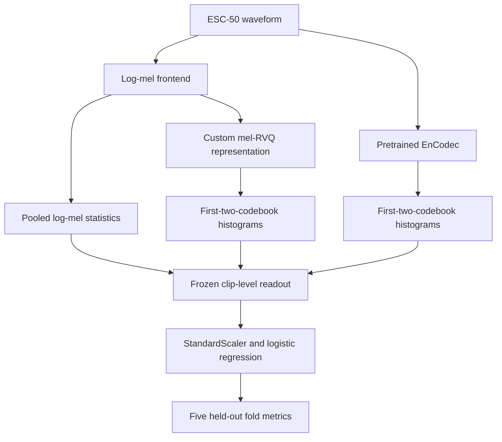

# Audio Representation Probe

## Event-Group Accessibility in Compact Audio Representations

### Scope

An exploratory benchmark of how much event-group information is accessible from
several compact audio representation interfaces under a fixed downstream
probing protocol. The project compares pooled log-mel statistics, a pretrained
EnCodec residual-vector-quantization (RVQ) code-histogram interface, and a
small custom mel-RVQ representation model on designed ESC-50 event groups.

This is **not** a semantic tokenizer, a waveform codec benchmark, an audio
foundation model, a sound-event-detection system, an embodied-agent evaluation,
or an audio world model.

### Research Question

> How much event-group information is accessible from different compact audio
> representation interfaces under a common downstream probe?

A follow-up diagnostic question is which stages of the representation pipeline
might limit downstream event-group accessibility. The archived experiments do
not causally identify such a stage.

The connection to
[ObsCodec](https://github.com/MacswareX/ObsCodec) is conceptual: both projects
inspect representation bottlenecks, while this benchmark adds a task-facing
event-group probe. The repositories are not integrated, and neither establishes
embodied-policy performance.

### Representations Under Test

| Representation | Frozen probe interface | Feature dimension |
|---|---|---:|
| Pooled log-mel reference | Per-bin temporal mean and standard deviation | 128 |
| Pretrained EnCodec | Normalized Bag-of-Codes histograms from the first two RVQ codebooks | 2,048 |
| Custom mel-RVQ representation | Normalized Bag-of-Codes histograms from the first two RVQ codebooks | 512 |

The first-K prefix is tested as an experimental interface; semantic superiority
of early RVQ stages is not assumed. Histogram pooling discards the order of the
underlying discrete code IDs.

The custom path is:

```text
waveform -> log-mel -> convolutional encoder -> continuous latent
         -> four-stage EMA RVQ -> quantized latent / discrete code IDs
         -> decoder -> temporally averaged 64-dimensional mel target
```

Its decoder does **not** reconstruct waveform audio. Its downstream probe reads
the discrete index histograms, not the decoder output.

### Pipeline



### Dataset and Event Groups

[ESC-50](https://github.com/karolpiczak/ESC-50) contains 2,000 five-second
clips in 50 categories and five official folds. This project maps the categories
into six designed event groups:

| Group | Clips |
|---|---:|
| Ambient / natural | 600 |
| Appliance / mechanical | 440 |
| Human activity | 360 |
| Water / liquid | 240 |
| Impact / contact | 240 |
| Object interaction | 120 |

This grouping is an experimental ontology, not a standard embodied-audio or
sound-event-detection taxonomy. Its majority-class baseline accuracy is 30.0%,
so macro-F1 is reported alongside accuracy. ESC-50 is downloaded locally and is
not tracked by this repository.

### Probe Protocol

```text
frozen representation -> clip-level readout -> StandardScaler
                      -> multinomial logistic regression
                      -> held-out fold accuracy and macro-F1
```

The probe uses `C=1.0`, `max_iter=2000`, and the five official ESC-50 folds.
Macro-F1 is computed over pooled out-of-fold predictions. The reported accuracy
spread is the population standard deviation across five folds, not a confidence
interval.

Linear probing measures downstream **linear accessibility under the selected
readout**. It does not measure mutual information, intrinsic representation
quality independently of the readout, or causal information loss.

The secondary comparison is:

```text
relative probe accuracy vs. log-mel
    = representation probe accuracy / pooled log-mel probe accuracy
```

This ratio can exceed 1.0 and is not a fraction of information retained.

### Results

The following numerical values are reproduced from the existing archived
ESC-50 results without recalculation or retraining:

| Representation | Accuracy | Macro-F1 | Relative probe accuracy vs. log-mel |
|---|---:|---:|---:|
| Log-mel mean + std | 0.4420 +/- 0.0089 | 0.3699 | 1.00 |
| EnCodec, first 2 codebooks | **0.5215 +/- 0.0197** | **0.4927** | **1.18** |
| Custom mel-RVQ, first 2 codebooks | 0.3775 +/- 0.0292 | 0.3450 | 0.85 |


The archived implementation also records nominal discrete index rates and local
encoding diagnostics:

| Representation | Nominal discrete index rate | Parameters | Local encode timing |
|---|---:|---:|---:|
| EnCodec | 1.5 kbps 2-codebook prefix; 6 kbps configured | 14.85M | 38.17 ms/clip |
| Custom mel-RVQ | 0.20 kbps prefix; 0.41 kbps full | 0.32M trainable | 1.43 ms/clip |

For the custom model these values describe a nominal discrete index stream, not
an end-to-end audio-codec rate. Framing and entropy-coding overhead are
excluded. Timings are not directly comparable: EnCodec timing starts from
waveform input, whereas custom timing starts from precomputed mel tensors.

### Interpretation

**[OBSERVED]** The selected EnCodec prefix-histogram interface scores 7.95
accuracy points above pooled log-mel. The custom prefix-histogram interface
scores 6.45 points below pooled log-mel. Custom codebook-0 utilization is 96.9%
with perplexity 185.9, so the first codebook is not fully inactive.

**[INFERENCE]** The custom objective optimizes reconstruction of a temporally
averaged mel target rather than event labels. This mismatch and the
order-discarding Bag-of-Codes readout are plausible contributors to weaker
event-group probe performance, but the archived comparison does not isolate
either mechanism.

**[HYPOTHESIS]** Continuous latents, later RVQ codebooks, or sequence-preserving
readouts may expose complementary event-group-discriminative information.
Stage-wise and readout-controlled probes are needed to test these possibilities.

### What These Results Do NOT Establish

- A semantic or event-aware tokenizer.
- An inherent semantic hierarchy or superior semantics in early RVQ codebooks.
- Independence between reconstruction quality and event-related task
  information.
- Quantization as the primary point where event-group accessibility decreases.
- Embodied-world-state estimation, robot-policy utility, or closed-loop
  performance.
- An apples-to-apples audio-codec efficiency or deployment-latency comparison.

### Reproduce

Create the configured CUDA environment:

```bash
conda env create -f environment.yml
conda activate audio-representation-probe
python scripts/0_check_env.py
```

Run the ESC-50 benchmark:

```bash
python scripts/1_prepare_data.py
python scripts/1_prepare_data.py --check
python scripts/2_mel_probe_baseline.py --device cuda
python scripts/6_train_mel_vqvae.py --device cuda
python scripts/3_extract_encodec_tokens.py --device cuda
python scripts/4_eval_event_group_probe.py --source esc50
python scripts/5_make_figures.py --source esc50
```

Run the no-download synthetic smoke test:

```bash
python scripts/2_mel_probe_baseline.py --self-test
python scripts/6_train_mel_vqvae.py --smoke
python scripts/4_eval_event_group_probe.py --source synthetic
python scripts/5_make_figures.py --source synthetic
```

The former `scripts/4_eval_event_retention.py` entry point remains available as
a compatibility wrapper. New evaluations write
`assets/results/event_group_probe_summary_<source>.json`; the original
`assets/results/event_retention_summary.json` remains an unchanged historical
artifact and can still be read by the figure-generation script.

Feature arrays are too large to be tracked by default. Exact custom-model
retraining is not currently guaranteed because a model checkpoint and complete
random-state record are not included.

### Repository Structure

```text
./                           Repository root
  configs/default.yaml       Experiment configuration
  scripts/                   Numbered data, training, and evaluation entry points
  src/                       Audio, representation, probe, and RVQ modules
  assets/figures/            Generated benchmark figures
  assets/results/            Archived JSON results; feature arrays ignored by Git
  TECHNICAL_REPORT.md        Extended methods, results, and limitations
```

### Limitations

- Event-group probing is a task-facing proxy, not evidence of robot-policy
  utility.
- ESC-50 is small, curated, and not collected from an embodied platform.
- The designed groups are subjective, heterogeneous, and imbalanced.
- Histogram and mean/std pooling remove temporal order.
- Representation dimensions and pretraining data are not controlled.
- EnCodec is broadly pretrained; the custom model is trained only on ESC-50.
- The custom representation model sees all clips without labels before fold-wise
  probing, making its current result a transductive diagnostic.
- The custom decoder reconstructs a temporally averaged 64-dimensional mel
  target, not waveform audio.
- One training run and five folds do not establish statistical superiority.

### Next Discriminating Experiments

1. Probe a representation-stage ladder: frontend features, continuous encoder
   latents, quantized latents, and discrete-code readouts.
2. Run frozen probes for individual codebooks and first-K prefixes without
   assuming that early stages are inherently semantic.
3. Compare sequence-preserving and Bag-of-Codes readouts with controlled
   feature dimensions.
4. Separate representation-model training strictly from held-out folds and
   repeat runs with multiple random seeds.
5. Only after those diagnostics, test objective interventions against explicit
   controlled baselines.

These experiments are proposals, not completed results.

### References

- Piczak, *ESC: Dataset for Environmental Sound Classification*, 2015.
- Zeghidour et al., *SoundStream: An End-to-End Neural Audio Codec*, 2021.
- Defossez et al., *High Fidelity Neural Audio Compression*, 2022.

Project code is MIT licensed. ESC-50 has its own CC BY-NC license.
