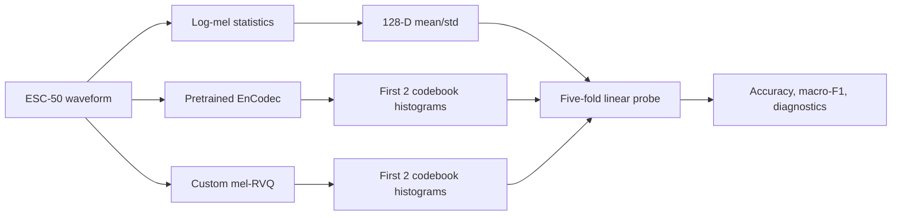
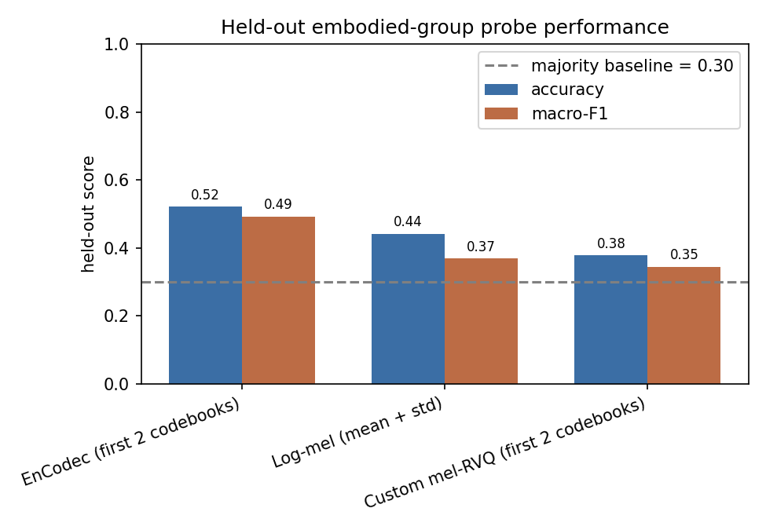

# Audio Event Tokenizer

An exploratory benchmark of whether compact audio representations retain
environmental event information. The project compares pooled log-mel features,
pretrained EnCodec tokens, and a small custom residual vector-quantized (RVQ)
mel autoencoder under one fixed linear-probe protocol.

This is a research-oriented implementation, not an audio foundation model,
waveform codec benchmark, or embodied-agent evaluation.

## Research motivation

Audio can expose contact, motion, machine state, and human activity when visual
evidence is incomplete. Audio foundation models often operate on continuous
features or discrete codec tokens, but reconstruction quality alone does not
show whether a token interface retains information useful for downstream
reasoning. This prototype asks a narrower question:

> How much coarse event-group information is linearly decodable from compressed
> audio representations?

The project extends the representation-bottleneck perspective of
[ObsCodec](https://github.com/MacswareX/ObsCodec) from multi-agent vector
observations to environmental audio. The connection is conceptual; the two
repositories are not an integrated system. ObsCodec measures reconstruction
under compact bottlenecks; this project adds a task-facing probe of whether an
audio representation retains designed event-group information. Neither result
establishes downstream embodied-agent performance.

## Pipeline



The tokenizer comparison is relevant to audio foundation model research because
discrete tokens provide a possible interface between audio encoders and sequence
models. This benchmark evaluates only the representation interface. It does not
train a language model over tokens or test temporal prediction.

## Dataset and labels

[ESC-50](https://github.com/karolpiczak/ESC-50) contains 2,000 five-second clips
in 50 classes and five official folds. This project maps those classes into six
designed event groups:

| Group | Clips |
|---|---:|
| Ambient / natural | 600 |
| Appliance / mechanical | 440 |
| Human activity | 360 |
| Water / liquid | 240 |
| Impact / contact | 240 |
| Object interaction | 120 |

This grouping is an experimental ontology, not a standard embodied-audio
taxonomy. Its majority-class baseline is 30.0%, so macro-F1 is reported with
accuracy. ESC-50 is downloaded locally and is not tracked by this repository.

## Benchmark

Each representation is reduced to one clip-level vector. A standardized
multinomial logistic-regression probe (`C=1.0`, `max_iter=2000`) is evaluated on
the five official ESC-50 folds.

| Representation | Probe interface | Dimension |
|---|---|---:|
| Log-mel | Temporal mean and standard deviation | 128 |
| EnCodec | Normalized histograms, first 2 codebooks | 2,048 |
| Custom mel-RVQ | Normalized histograms, first 2 codebooks | 512 |

Macro-F1 is computed over pooled out-of-fold predictions. The reported accuracy
spread is the population standard deviation across five folds, not a confidence
interval.

## Results

| Representation | Accuracy | Macro-F1 | Relative accuracy |
|---|---:|---:|---:|
| Log-mel mean + std | 0.4420 +/- 0.0089 | 0.3699 | 1.00 |
| EnCodec, first 2 codebooks | **0.5215 +/- 0.0197** | **0.4927** | **1.18** |
| Custom mel-RVQ, first 2 codebooks | 0.3775 +/- 0.0292 | 0.3450 | 0.85 |



Under this probe, EnCodec histograms exceed the pooled log-mel reference by
7.95 accuracy points. The custom model falls 6.45 points below log-mel.
Codebook-0 utilization is 96.9% with perplexity 185.9, ruling out collapse
as an explanation. The underperformance likely reflects a training objective
(pooled-mel mean reconstruction) that provides no event-discriminative signal,
combined with a bag-of-codes probe that discards temporal order. This negative
result motivates two well-defined next steps: preserve token order in
evaluation, and introduce an explicit retention or contrastive objective.

The project also records nominal stream and local implementation diagnostics:

| Representation | Nominal stream | Parameters | Local encode timing |
|---|---:|---:|---:|
| EnCodec | 1.5 kbps 2-codebook prefix; 6 kbps configured | 14.85M | 38.17 ms/clip |
| Custom mel-RVQ | 0.20 kbps prefix; 0.41 kbps full | 0.32M trainable | 1.43 ms/clip |

These timings are not an end-to-end deployment comparison: EnCodec timing starts
from waveform input, while custom timing starts from precomputed mel tensors.
The nominal rates exclude framing and entropy-coding overhead.

## Reproduce

Create the tested CUDA environment:

```bash
conda env create -f environment.yml
conda activate audio-event-tokenizer
python scripts/0_check_env.py
```

Run the ESC-50 benchmark:

```bash
python scripts/1_prepare_data.py
python scripts/1_prepare_data.py --check
python scripts/2_mel_probe_baseline.py --device cuda
python scripts/6_train_mel_vqvae.py --device cuda
python scripts/3_extract_encodec_tokens.py --device cuda
python scripts/4_eval_event_retention.py --source esc50
python scripts/5_make_figures.py --source esc50
```

Run the no-download smoke test:

```bash
python scripts/2_mel_probe_baseline.py --self-test
python scripts/6_train_mel_vqvae.py --self-test
python scripts/4_eval_event_retention.py --source synthetic
python scripts/5_make_figures.py --source synthetic
```

The local archived feature arrays can reproduce probe aggregation and figures,
but they are too large to be tracked by default. Exact custom-tokenizer
retraining is not currently guaranteed because a model checkpoint and complete
random-state record are not included.

## Repository structure

```text
audio-event-tokenizer/
  configs/default.yaml       Experiment configuration
  scripts/                   Numbered data, training, and evaluation entry points
  src/                       Audio, representation, probe, and RVQ modules
  assets/figures/            Generated benchmark figures
  assets/results/            Compact JSON results; feature arrays ignored by Git
  TECHNICAL_REPORT.md        Extended methods, results, and limitations
```

## Limitations

- Event-group probing is a proxy, not evidence of robot-policy utility.
- ESC-50 is small, curated, and not collected from an embodied platform.
- The designed groups are subjective, heterogeneous, and imbalanced.
- Histogram and mean/std pooling remove temporal order.
- Representation dimensions and pretraining data are not controlled.
- EnCodec is broadly pretrained; the custom model is trained only on ESC-50.
- The custom tokenizer sees all clips without labels before fold-wise probing,
  making its current result a transductive diagnostic.
- The custom decoder reconstructs a time-averaged mel target, not audio.
- One training run and five folds do not establish statistical superiority.

## Future extensions

1. Train the custom tokenizer fold-wise or pretrain it on a separate corpus.
2. Compare equal-dimensional and sequence-preserving probe interfaces.
3. Evaluate first, later, and shuffled codebooks to test coarse-token claims.
4. Add noise, mixture, and cross-dataset robustness experiments.
5. Introduce an explicit event-retention objective and report seed variance.
6. Only after these controls, study causal token prediction on synchronized
   audio, action, and state trajectories.

## References

- Piczak, *ESC: Dataset for Environmental Sound Classification*, 2015.
- Zeghidour et al., *SoundStream: An End-to-End Neural Audio Codec*, 2021.
- Defossez et al., *High Fidelity Neural Audio Compression*, 2022.

Project code is MIT licensed. ESC-50 has its own CC BY-NC license.
